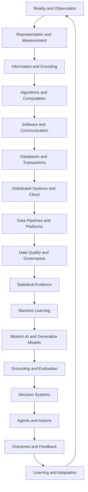
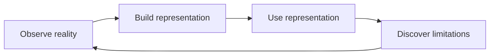
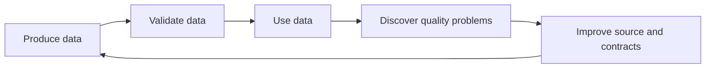
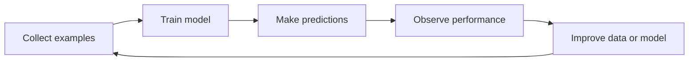
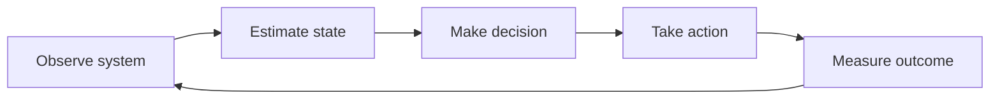
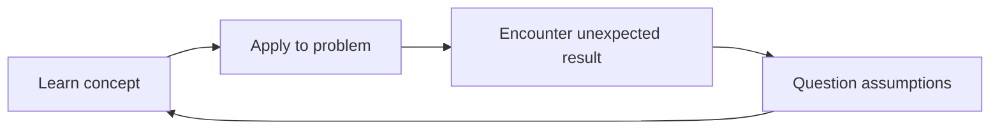
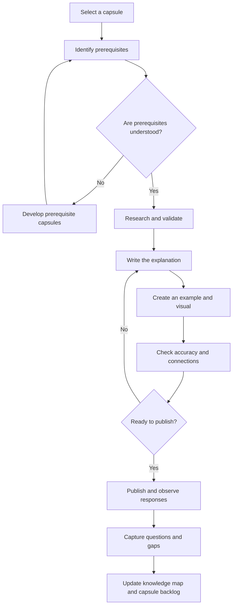

# Capsule Architecture & Publishing Guide
## Data & AI Foundations
### From Understanding Reality to Making Better Decisions

**Author:** Ankit Rathi  
**Project:** Data & AI Foundations  
**Purpose:** Define the capsule inventory, conceptual dependencies, cross-connections, feedback loops, and a practical approach to selecting and publishing learning capsules.

---

# 1. Purpose of This Document

This document explains how to organise, develop, connect, and publish the individual learning capsules that make up Data & AI Foundations.

It establishes three complementary structures:

1. **Chapter structure:** Where a capsule belongs in the book and learning journey.
2. **Dependency structure:** What a reader should understand before encountering a capsule.
3. **Publishing structure:** When to create and publish a capsule based on readiness, relevance, and connections to other ideas.

These structures serve different purposes.

The book should follow a carefully designed learning sequence. Public content, however, can be published in a different order to help people discover individual ideas and gradually develop a connected understanding.

**Important principle:** The capsule inventory is a working knowledge architecture, not a fixed content quota. Capsules may be merged, split, expanded, or removed as the project develops.

---

# 2. How to Identify Capsules

Each capsule receives a stable identifier:

`DAF-[Chapter]-[Capsule]`

For example:

- `DAF-002-001`: First capsule in Chapter 2.
- `DAF-013-003`: Third capsule in Chapter 13.
- `DAF-029-004`: Fourth capsule in Chapter 29.

Use these identifiers consistently across:

- GitHub Markdown files.
- Knowledge maps.
- Dependency diagrams.
- Sketch notes.
- LinkedIn posts.
- YouTube videos.
- Blog articles.
- Course material.
- Assessments and exercises.

A capsule should represent one meaningful learning unit, not necessarily one social media post.

Some capsules may be short and intuitive. Others may require multiple explanations, examples, diagrams, and exercises.

---

# 3. Complete Capsule Inventory

The following is the initial proposed capsule inventory across all six parts and 39 chapters.

The inventory contains 156 capsule ideas as a planning baseline. This is not a target that must be achieved.

## Part I — Understanding Reality

**Purpose:** Understand how humans observe, interpret, measure, and represent the world.

### Chapter 1 — Why Do We Need to Understand the World?

- `DAF-001-001` — Why observing the world is not the same as understanding it
- `DAF-001-002` — How mental models help us make sense of reality
- `DAF-001-003` — Why human experience can be misleading
- `DAF-001-004` — How asking better questions improves understanding

### Chapter 2 — How Can We Represent Reality?

- `DAF-002-001` — A map is not the territory
- `DAF-002-002` — Every representation leaves something out
- `DAF-002-003` — Why the same reality needs different representations
- `DAF-002-004` — How data models encode decisions about reality

### Chapter 3 — How Do We Measure What We Observe?

- `DAF-003-001` — What exactly are we measuring?
- `DAF-003-002` — Measurement, quantities, and units
- `DAF-003-003` — Accuracy, precision, and uncertainty
- `DAF-003-004` — How metrics can distort the reality they measure

### Chapter 4 — How Do We Distinguish Patterns from Coincidence?

- `DAF-004-001` — Patterns versus randomness
- `DAF-004-002` — Why correlation does not establish causation
- `DAF-004-003` — How sample size changes what we can conclude
- `DAF-004-004` — How selection bias creates misleading patterns

### Chapter 5 — Why Do We Need Models of the World?

- `DAF-005-001` — What is a model, and why do we need one?
- `DAF-005-002` — Why every model is a simplification
- `DAF-005-003` — How assumptions shape a model
- `DAF-005-004` — Simplicity versus complexity in modelling

### Chapter 6 — How Can Knowledge Outlive Human Memory?

- `DAF-006-001` — Why humans externalise knowledge
- `DAF-006-002` — How information survives beyond individual memory
- `DAF-006-003` — Why classification and structure matter
- `DAF-006-004` — Why recorded knowledge still needs context

---

## Part II — Representing and Processing Information

**Purpose:** Understand how information is encoded and how systematic computation becomes possible.

### Chapter 7 — What Is Information?

- `DAF-007-001` — Data versus information: what is the difference?
- `DAF-007-002` — Why context changes the meaning of data
- `DAF-007-003` — More data does not necessarily mean more knowledge
- `DAF-007-004` — What makes information useful and trustworthy?

### Chapter 8 — How Can Information Be Encoded?

- `DAF-008-001` — What does it mean to encode information?
- `DAF-008-002` — Why computers use binary
- `DAF-008-003` — How text, images, and sound become digital information
- `DAF-008-004` — Compression, formats, and the trade-off between size and fidelity

### Chapter 9 — How Can We Make Reasoning Systematic?

- `DAF-009-001` — What is an algorithm?
- `DAF-009-002` — Why complex problems need decomposition
- `DAF-009-003` — How conditions, loops, and sequences create systematic reasoning
- `DAF-009-004` — Why algorithms have different efficiency characteristics

### Chapter 10 — What Makes a Machine Computational?

- `DAF-010-001` — What does it mean for a machine to compute?
- `DAF-010-002` — Instructions, state, and memory
- `DAF-010-003` — How abstraction makes computation manageable
- `DAF-010-004` — What can and cannot be computed?

### Chapter 11 — How Do We Organize Computation?

- `DAF-011-001` — Why computers need operating systems
- `DAF-011-002` — Processes, threads, and resource management
- `DAF-011-003` — Concurrency versus parallelism
- `DAF-011-004` — How software structure, interfaces, and testing enable change

### Chapter 12 — How Can Machines Exchange Information?

- `DAF-012-001` — Why computers need to communicate
- `DAF-012-002` — How networks move information through packets
- `DAF-012-003` — Why protocols and standards matter
- `DAF-012-004` — APIs, latency, and the challenges of communication

---

## Part III — Building Systems Around Data

**Purpose:** Understand how information becomes persistent, organised, scalable, and dependable.

### Chapter 13 — How Do We Organize Data for Reliable Use?

- `DAF-013-001` — Why databases exist
- `DAF-013-002` — How tables, relationships, and data models organise information
- `DAF-013-003` — Keys, constraints, and data integrity
- `DAF-013-004` — Why database schemas evolve

### Chapter 14 — How Can We Keep Data Correct When Many Things Happen at Once?

- `DAF-014-001` — What is a transaction?
- `DAF-014-002` — Why ACID properties matter
- `DAF-014-003` — What happens when multiple operations happen simultaneously?
- `DAF-014-004` — Locks, isolation, and consistency trade-offs

### Chapter 15 — Why Are Recording Transactions and Analyzing Data Different Problems?

- `DAF-015-001` — Why operational and analytical systems have different needs
- `DAF-015-002` — OLTP versus OLAP
- `DAF-015-003` — Why analytical data needs different structures
- `DAF-015-004` — How operational data becomes analytical information

### Chapter 16 — What Happens When Data Outgrows a Single Machine?

- `DAF-016-001` — What happens when one machine is no longer enough?
- `DAF-016-002` — Vertical versus horizontal scaling
- `DAF-016-003` — Partitioning, sharding, and distributing data
- `DAF-016-004` — Replication and the trade-offs of distributed storage

### Chapter 17 — How Can Distributed Systems Work Reliably?

- `DAF-017-001` — Why distributed systems are fundamentally difficult
- `DAF-017-002` — Partial failure: why one component failing changes everything
- `DAF-017-003` — Why retries can create duplicates
- `DAF-017-004` — Ordering, delivery guarantees, recovery, and observability

### Chapter 18 — What Changes When Computing Becomes a Service?

- `DAF-018-001` — Why computing became a service
- `DAF-018-002` — Virtualisation, containers, and isolation
- `DAF-018-003` — IaaS, PaaS, and SaaS
- `DAF-018-004` — Serverless, elasticity, and the economics of cloud computing

### Chapter 19 — How Do We Turn Data Processing into a Reliable Platform?

- `DAF-019-001` — What is a data pipeline?
- `DAF-019-002` — Batch versus streaming processing
- `DAF-019-003` — Event time versus processing time
- `DAF-019-004` — Why reliable pipelines need orchestration, testing, and observability

### Chapter 20 — How Can We Make Data Trustworthy and Useful Across an Organization?

- `DAF-020-001` — What does data quality actually mean?
- `DAF-020-002` — Why data ownership and accountability matter
- `DAF-020-003` — Metadata, lineage, and understanding data context
- `DAF-020-004` — Data contracts, data products, and organisational trust

---

## Part IV — Turning Data into Intelligence

**Purpose:** Understand how evidence, statistics, learning, and AI enable intelligent capabilities.

### Chapter 21 — What Does It Mean to Learn from Data?

- `DAF-021-001` — What does it mean to learn from data?
- `DAF-021-002` — Descriptive, diagnostic, predictive, and prescriptive analytics
- `DAF-021-003` — Why samples may not represent the real world
- `DAF-021-004` — Why performance on known data does not guarantee generalisation

### Chapter 22 — How Can We Reason Under Uncertainty?

- `DAF-022-001` — Why uncertainty is unavoidable
- `DAF-022-002` — Understanding probability and distributions
- `DAF-022-003` — Conditional probability and Bayesian reasoning
- `DAF-022-004` — Estimation, inference, and hypothesis testing

### Chapter 23 — How Can We Tell What Causes What?

- `DAF-023-001` — Association versus causation
- `DAF-023-002` — How confounding variables mislead us
- `DAF-023-003` — Why experiments help establish causal relationships
- `DAF-023-004` — Prediction versus explanation

### Chapter 24 — How Can Machines Learn from Examples?

- `DAF-024-001` — What is machine learning?
- `DAF-024-002` — Supervised, unsupervised, and reinforcement learning
- `DAF-024-003` — Features, labels, and learning from examples
- `DAF-024-004` — Bias, variance, validation, and model evaluation

### Chapter 25 — Why Did Artificial Intelligence Evolve from Rules to Learning?

- `DAF-025-001` — What do we mean by artificial intelligence?
- `DAF-025-002` — Why rule-based AI and expert systems emerged
- `DAF-025-003` — Why manually defined rules reached their limits
- `DAF-025-004` — How statistical learning changed AI

### Chapter 26 — How Can Machines Learn Useful Representations?

- `DAF-026-001` — Why representations matter for machine learning
- `DAF-026-002` — From feature engineering to learned representations
- `DAF-026-003` — How neural networks learn patterns
- `DAF-026-004` — Why deep learning changed representation learning

### Chapter 27 — How Can Machines Represent Meaning and Relationships?

- `DAF-027-001` — What does it mean for a machine to represent meaning?
- `DAF-027-002` — How embeddings represent relationships
- `DAF-027-003` — Semantic similarity versus actual understanding
- `DAF-027-004` — Knowledge graphs, vector representations, and context

### Chapter 28 — How Can Machines Generate New Content?

- `DAF-028-001` — Prediction versus generation
- `DAF-028-002` — How language becomes tokens
- `DAF-028-003` — Attention and the transformer architecture
- `DAF-028-004` — Why context windows and probabilistic generation matter

### Chapter 29 — How Can We Ground and Evaluate AI Outputs?

- `DAF-029-001` — Why AI needs information beyond its trained parameters
- `DAF-029-002` — Retrieval-augmented generation: retrieval versus generation
- `DAF-029-003` — Why plausible AI outputs can still be wrong
- `DAF-029-004` — How to evaluate grounding, reliability, and AI outputs

---

## Part V — From Intelligence to Decisions and Action

**Purpose:** Connect intelligence to judgement, decisions, actions, and consequences.

### Chapter 30 — Why Doesn't Better Information Automatically Lead to Better Decisions?

- `DAF-030-001` — Why better information does not automatically produce better decisions
- `DAF-030-002` — How cognitive biases influence decisions
- `DAF-030-003` — Why objectives and constraints matter
- `DAF-030-004` — Why the best prediction is not always the best decision

### Chapter 31 — How Can We Make Decisions Under Uncertainty?

- `DAF-031-001` — How expected value helps compare choices
- `DAF-031-002` — Risk versus uncertainty
- `DAF-031-003` — How decision trees help structure choices
- `DAF-031-004` — Opportunity cost and the value of missing information

### Chapter 32 — How Can We Build Systems That Support Decisions?

- `DAF-032-001` — What is a decision-support system?
- `DAF-032-002` — How dashboards and metrics influence behaviour
- `DAF-032-003` — Rules, scores, recommendations, and human judgement
- `DAF-032-004` — How to measure decision quality

### Chapter 33 — What Changes When Machines Can Take Actions?

- `DAF-033-001` — Automation versus autonomy
- `DAF-033-002` — From chatbots to AI agents
- `DAF-033-003` — How agents use tools, state, memory, and plans
- `DAF-033-004` — Why autonomous actions need permissions and safeguards

### Chapter 34 — How Much Should We Trust an Intelligent System?

- `DAF-034-001` — Accuracy versus trust
- `DAF-034-002` — Why confidence and correctness are different
- `DAF-034-003` — Human oversight, accountability, and governance
- `DAF-034-004` — Privacy, security, and the risks of intelligent systems

### Chapter 35 — How Can Systems Learn from Their Outcomes?

- `DAF-035-001` — Why outcomes must feed back into systems
- `DAF-035-002` — Feedback loops and control systems
- `DAF-035-003` — How reinforcement learning uses feedback
- `DAF-035-004` — Model drift and continuous improvement

---

## Part VI — Navigating an Uncertain Future

**Purpose:** Develop the ability to evaluate unfamiliar technologies and think beyond today's tools.

### Chapter 36 — What Remains Constant When Technologies Change?

- `DAF-036-001` — Why problems outlive technologies
- `DAF-036-002` — Principles versus implementations
- `DAF-036-003` — How abstraction helps us survive technology changes
- `DAF-036-004` — Why technology dependency creates risk

### Chapter 37 — How Should We Evaluate an Emerging Technology?

- `DAF-037-001` — Start with the problem, not the technology
- `DAF-037-002` — Capability versus marketing claims
- `DAF-037-003` — How to evaluate evidence behind emerging technologies
- `DAF-037-004` — Build, buy, adapt, or wait: understanding the trade-offs

### Chapter 38 — How Do We Think in Systems Rather Than Tools?

- `DAF-038-001` — What is systems thinking?
- `DAF-038-002` — Why local optimisation can damage the whole system
- `DAF-038-003` — Dependencies, feedback, and second-order effects
- `DAF-038-004` — How organisational coherence affects technical outcomes

### Chapter 39 — How Can We Keep Learning in a Changing Field?

- `DAF-039-001` — Learning how to learn
- `DAF-039-002` — Building a personal knowledge system
- `DAF-039-003` — Moving from tutorials to mental models
- `DAF-039-004` — How to apply fundamentals to unfamiliar problems

---

# 4. Dependency Architecture

The curriculum is not a simple sequence of independent capsules.

It is a network of related concepts.

Some capsules have strong prerequisites. Others can be understood independently. Some become significantly more meaningful when revisited after learning another concept.

## 4.1 Primary dependency chain

The main conceptual progression is:

This is the main narrative of the book.

It is not a rigid technical dependency graph. Some concepts can be introduced earlier through intuition and developed more deeply later.

The final connection is particularly important: learning from outcomes improves how we observe, represent, and understand reality in the next cycle.

## 4.2 Cross-connectivity network

The following recurring concepts connect capsules across different parts of the curriculum.

```mermaid
flowchart TD
    R["Representation"] --> S["Schemas and Data Models"]
    R --> T["Features and Embeddings"]
    R --> U["Metrics and Dashboards"]

    V["Uncertainty"] --> W["Measurement"]
    V --> X["Statistics"]
    V --> Y["Predictions"]
    V --> Z["Decision Making"]

    AA["Data Quality and Provenance"] --> AB["Analytical Evidence"]
    AA --> AC["Training Data"]
    AA --> AD["AI Grounding"]

    AE["Scale and Complexity"] --> AF["Algorithms"]
    AE --> AG["Distributed Systems"]
    AE --> AH["AI Infrastructure"]

    AI["Reliability and Failure"] --> AJ["Software"]
    AI --> AK["Networks"]
    AI --> AL["Data Pipelines"]
    AI --> AM["AI Agents"]

    AN["Evaluation"] --> AO["Models"]
    AN --> AP["Predictions"]
    AN --> AQ["AI Outputs"]
    AN --> AR["Decisions"]

    AS["Feedback"] --> AT["Control Systems"]
    AS --> AU["Reinforcement Learning"]
    AS --> AV["Model Monitoring"]
    AS --> AW["Organisational Learning"]

    AX["Human and Organisational Context"] --> AY["Interpretation"]
    AX --> AZ["Judgement"]
    AX --> BA["Accountability"]
    AX --> BB["Consequences"]
```

These are intellectual threads, not additional chapters.

They should recur throughout the learning journey so that readers gradually recognise the same principles appearing in different technologies and disciplines.

## 4.3 Important cross-connections

| Starting concept | Connects to | Why the connection matters |
|---|---|---|
| A map is not the territory | Database schemas, features, embeddings | Every data or AI representation is a selective model of reality |
| Measurement | Statistics, metrics, model evaluation | What we measure determines what we can claim |
| Information needs context | Data quality, metadata, RAG | Information without context can be misleading |
| Algorithms | Query optimisation, distributed processing, AI | Computational principles appear at different scales |
| Concurrency | Transactions, streaming, agents | Simultaneous operations create coordination problems |
| Partial failure | Data pipelines, cloud, agents | Reliability is a systems problem, not just a software problem |
| Sampling and bias | Training data, model performance, fairness | Models inherit limitations from their evidence |
| Probability | Predictions, calibration, decisions | A prediction is uncertain; a decision must account for consequences |
| Representation learning | Embeddings, semantic search, LLMs | Modern AI depends heavily on how information is represented |
| Grounding | Data quality, retrieval, trust | AI output quality depends partly on the evidence available to it |
| Evaluation | ML, AI, dashboards, business decisions | Technical accuracy alone does not establish usefulness |
| Feedback | Control systems, agents, model drift | Intelligent systems need mechanisms to learn from outcomes |

---

# 5. Feedback Loops

Several important feedback loops should be taught explicitly.

They connect concepts that might otherwise appear unrelated.

## 5.1 Knowledge and representation loop

Our understanding of reality improves as we use representations, discover their limitations, and revise them.

Connections:
- Observation.
- Measurement.
- Models.
- Data modelling.
- Machine learning representations.

## 5.2 Data quality loop

Data quality is not just a one-time validation activity.

It is a continuous process involving producers, consumers, ownership, feedback, and correction.

Connections:
- Data quality.
- Metadata.
- Data contracts.
- Data products.
- Governance.

## 5.3 Machine learning loop

Machine learning systems depend on data, training, evaluation, deployment, monitoring, and improvement.

Connections:
- Sampling.
- Probability.
- Machine learning.
- Evaluation.
- Model drift.

## 5.4 Decision and control loop

A decision changes the system being observed.

The result of an action provides feedback for the next decision.

Connections:
- Measurement.
- Prediction.
- Decision theory.
- Automation.
- Control systems.
- Reinforcement learning.

## 5.5 Human learning loop

This is also the process the project itself should encourage.

Readers should not simply memorise explanations. They should apply concepts, challenge assumptions, and refine their understanding.

## 5.6 Revisit loops at increasing depth

A useful teaching strategy is to introduce a loop intuitively and revisit it later with greater technical depth.

For example:

| Learning stage | Feedback concept |
|---|---|
| Part I | How new observations change our understanding |
| Part III | How pipeline monitoring improves data reliability |
| Part IV | How model evaluation and retraining improve learning systems |
| Part V | How control systems and agents use feedback |
| Part VI | How organisations learn and adapt |

This creates intellectual progression without unnecessary repetition.

---

# 6. Distinguish Prerequisites from Cross-Links

This distinction is essential when maintaining the capsule dependency network.

## Prerequisite

A concept the reader should understand before learning another concept at the intended depth.

Example:

Understanding probability is a prerequisite for developing a rigorous understanding of model confidence and uncertainty.

## Cross-link

A concept that enriches understanding but does not have to be learned first.

Example:

Understanding database schemas can enrich a discussion about AI representations, but it is not a strict prerequisite for understanding the idea of embeddings.

## Three dependency levels

Use the following classifications:

| Level | Meaning | Example |
|---|---|---|
| Essential | Needed to understand the core mechanism | Probability before Bayesian reasoning |
| Helpful | Makes the explanation easier or richer | Measurement before model evaluation |
| Connected | Useful for synthesis or later revisiting | Embeddings connected to data modelling |

Do not make the dependency network unnecessarily restrictive.

A reader should be able to discover an individual capsule without having completed the entire curriculum.

Where necessary, provide a short prerequisite explanation or link to an earlier capsule.

---

# 7. Content Creation Strategy

The order in which capsules are developed should not necessarily match the order in which they are published.

Maintain three complementary queues.

## Queue 1 — Foundation

Capsules that establish concepts required by many later capsules.

Examples:
- Representation.
- Measurement.
- Information.
- Algorithms.
- Probability.
- Models.

These should be developed early because they support the rest of the curriculum.

## Queue 2 — Discovery

Capsules with strong real-world relevance, curiosity, or recognisable problems.

Examples:
- Why AI can be confidently wrong.
- Correlation versus causation.
- Why retries create duplicates.
- Why more data does not necessarily mean better decisions.

These can be published early to attract an audience.

## Queue 3 — Synthesis

Capsules that combine multiple ideas and demonstrate connected thinking.

Examples:
- Why better data does not guarantee better decisions.
- How AI agents fail.
- Why local optimisation can damage a system.
- How organisations learn from outcomes.

These should generally be developed after their foundational connections are understood.

A capsule can belong to more than one queue. These queues describe its role, not an exclusive classification.

---

# 8. Recommended First 20 Capsules

The following sequence deliberately alternates between foundations, practical engineering, AI, and decision-making.

It provides variety while establishing the project's intellectual identity.

| Order | Capsule ID | Topic | Reason for selection |
|---:|---|---|---|
| 1 | DAF-002-001 | A map is not the territory | Establishes representation as a central idea |
| 2 | DAF-007-001 | Data versus information | Familiar concept with an important distinction |
| 3 | DAF-007-003 | More data does not necessarily mean more knowledge | Challenges a common assumption |
| 4 | DAF-003-003 | Accuracy, precision, and uncertainty | Builds measurement literacy |
| 5 | DAF-005-002 | Why every model is a simplification | Connects representation and modelling |
| 6 | DAF-004-002 | Why correlation does not establish causation | High practical relevance |
| 7 | DAF-009-001 | What is an algorithm? | Introduces systematic computation |
| 8 | DAF-013-001 | Why databases exist | Natural bridge into data engineering |
| 9 | DAF-015-002 | OLTP versus OLAP | Familiar architectural distinction |
| 10 | DAF-017-003 | Why retries can create duplicates | Memorable engineering failure |
| 11 | DAF-020-001 | What does data quality actually mean? | Connects engineering with trust |
| 12 | DAF-021-001 | What does it mean to learn from data? | Bridge into intelligence |
| 13 | DAF-022-002 | Understanding probability and distributions | Foundation for reasoning under uncertainty |
| 14 | DAF-023-001 | Association versus causation | Extends the earlier correlation concept |
| 15 | DAF-024-001 | What is machine learning? | Establishes the ML mental model |
| 16 | DAF-028-001 | Prediction versus generation | Clarifies modern AI |
| 17 | DAF-029-003 | Why plausible AI outputs can still be wrong | Strong discovery potential |
| 18 | DAF-030-004 | Why the best prediction is not always the best decision | Connects intelligence to outcomes |
| 19 | DAF-033-001 | Automation versus autonomy | Relevant to agentic AI |
| 20 | DAF-038-002 | Why local optimisation can damage the whole system | Demonstrates systems thinking |

This sequence is a publishing recommendation, not a replacement for the book's chapter sequence.

---

# 9. Capsule Prioritisation Framework

Use five dimensions to decide which capsule to develop next.

Score each dimension from 1 to 5.

| Dimension | Question |
|---|---|
| Foundation value | How many other concepts depend on it? |
| Audience relevance | How relevant or interesting is it to the intended audience? |
| Connection potential | How many useful connections can it establish? |
| Content readiness | Can it be explained accurately with a good example today? |
| Visual potential | Can it be explained through a memorable diagram or illustration? |

Maximum score: 25.

Suggested interpretation:

| Score | Priority |
|---:|---|
| 21–25 | High priority |
| 16–20 | Consider next |
| 5–15 | Develop foundations or research further |

This is a prioritisation aid, not an automatic decision.

Do not let popularity compensate for a weak understanding of the subject.

If a capsule cannot be explained confidently, research it or develop its prerequisites first.

---

# 10. Dependency-Aware Content Workflow

Use the following workflow for each capsule.

## Capsule workflow checklist

- [ ] Select a capsule.
- [ ] Identify its chapter and role.
- [ ] Identify essential prerequisites.
- [ ] Identify helpful concepts and cross-links.
- [ ] Research and validate the subject.
- [ ] Define the key learning outcome.
- [ ] Develop the explanation.
- [ ] Select a concrete example.
- [ ] Create an appropriate visual.
- [ ] Check assumptions and limitations.
- [ ] Check connections to other capsules.
- [ ] Review technical accuracy.
- [ ] Publish the content.
- [ ] Capture audience questions and feedback.
- [ ] Update the capsule register and knowledge map.

---

# 11. Master Capsule Register

Maintain one master capsule register as the source of truth.

Recommended fields:

| Field | Description |
|---|---|
| Capsule ID | Stable identifier |
| Part | One of the six learning parts |
| Chapter | Chapter number and title |
| Capsule title | Fundamental question or concept |
| Capsule type | Foundation, Connecting, or Synthesis |
| Prerequisites | Essential capsule IDs |
| Helpful concepts | Related concepts that improve understanding |
| Cross-links | Other connected capsule IDs |
| Key takeaway | What the reader should remember |
| Example | Concrete illustration |
| Visual type | Diagram, sketch-note, comparison, etc. |
| Research status | Not started, Researching, Validated |
| Writing status | Backlog, Draft, Review, Ready |
| Publishing status | Not published, Published |
| Priority | Score or priority level |
| Content links | LinkedIn, YouTube, blog, etc. |
| Notes | Open questions and future improvements |

## Recommended status values

Research:
- Not Started
- Researching
- Validated

Writing:
- Backlog
- Draft
- Review
- Ready

Publishing:
- Not Published
- Published
- Needs Revision

Avoid creating too many workflow statuses.

The register should help manage work, not become another project to maintain.

## One source, three views

Generate or maintain these views from the same register:

1. Curriculum view — chapter and syllabus order.
2. Dependency view — prerequisites and cross-links.
3. Publishing view — current priority and readiness.

Do not manually maintain three independent lists.

---

# 12. Twelve-Week Publishing Plan

The following plan is a practical starting point.

| Week | Main topic | Secondary connection |
|---:|---|---|
| 1 | A map is not the territory | Data models |
| 2 | Data versus information | Context and metadata |
| 3 | More data does not mean more knowledge | Evidence |
| 4 | Accuracy versus precision | Measurement uncertainty |
| 5 | Every model is a simplification | Machine learning |
| 6 | Correlation versus causation | Experiments and statistics |
| 7 | Why databases exist | Data modelling |
| 8 | OLTP versus OLAP | Data architecture |
| 9 | Why retries create duplicates | Distributed systems |
| 10 | What data quality really means | Data contracts and governance |
| 11 | Why AI can sound confident but be wrong | Grounding and evaluation |
| 12 | Automation versus autonomy | AI agents and feedback |

## Suggested weekly production cycle

| Day | Activity |
|---|---|
| Day 1 | Research and understand the concept |
| Day 2 | Write the explanation and choose an example |
| Day 3 | Create the sketch-note or diagram |
| Day 4 | Publish a LinkedIn post |
| Day 5 | Adapt it into a short video |
| Day 6 | Capture questions and improve the explanation |
| Day 7 | Review and choose the next capsule |

The cadence is flexible.

One well-understood capsule is more valuable than several superficial posts.

---

# 13. One Capsule, Multiple Content Formats

A capsule should be a reusable intellectual asset rather than a disposable social media post.

Example:

## DAF-002-001 — A Map Is Not the Territory

**Core intellectual asset:** An explanation of why every representation is a selective model of reality.

It can produce:

| Format | Output |
|---|---|
| GitHub | Canonical capsule and references |
| LinkedIn | Short explanation and discussion |
| Instagram | Sketch-note or carousel |
| YouTube Shorts | Short visual explanation |
| YouTube | Longer explanation and examples |
| Blog | Expanded conceptual article |
| Book | Detailed explanation, diagrams, and exercises |
| Course | Demonstrations and interactive activities |

The same capsule can connect to:

- Measurement.
- Data modelling.
- Features.
- Embeddings.
- AI representations.
- Model evaluation.

Over time, readers should recognise recurring ideas and connections.

That is how the project builds a recognisable intellectual identity rather than simply publishing individual technology tips.

---

# 14. Recommended Starting Cluster

Start with these five capsules:

1. `DAF-002-001` — A map is not the territory.
2. `DAF-007-001` — Data versus information.
3. `DAF-007-003` — More data does not necessarily mean more knowledge.
4. `DAF-003-003` — Accuracy, precision, and uncertainty.
5. `DAF-005-002` — Why every model is a simplification.

Together, they establish this conceptual cluster:

**Reality → Representation → Measurement → Information → Models → Knowledge**

This is a strong starting point because it introduces the central philosophy of Data & AI Foundations before moving into specific technologies.

Develop the cluster sufficiently to establish a consistent explanation style, but do not wait for the entire cluster to be complete before publishing useful individual capsules.

---

# 15. Important Rules for Maintaining the Capsule Architecture

1. Do not treat 156 capsules as a fixed target.
2. Do not force every chapter to have the same number of capsules.
3. Do not confuse publishing order with learning order.
4. Distinguish essential prerequisites from helpful cross-links.
5. Revisit important ideas at greater depth rather than repeating the same explanation.
6. Preserve stable capsule IDs when editing titles or content.
7. Add new capsules only when they improve the learning journey.
8. Merge capsules when their distinction creates unnecessary fragmentation.
9. Use real examples from multiple domains.
10. Keep the dependency network understandable and useful.
11. Maintain one master capsule register.
12. Update the knowledge map when important new connections emerge.
13. Use audience feedback to improve explanations, not dictate the curriculum.
14. Keep the repository as the intellectual source of truth.
15. Prioritise durable understanding over publishing volume.

---

# 16. Final Guiding Principle

The 39 chapters define the learning journey.

The capsules break that journey into meaningful units.

The dependency network explains how those units relate.

The feedback loops show how ideas evolve and reinforce one another.

The publishing strategy determines how those ideas reach people.

These are different views of one connected learning system.

**The objective is not to publish 156 disconnected pieces of content. It is to gradually build a connected body of knowledge that helps people understand today's Data and AI technologies and reason independently about tomorrow's unknown ones.**

That is the purpose of the capsule architecture.
